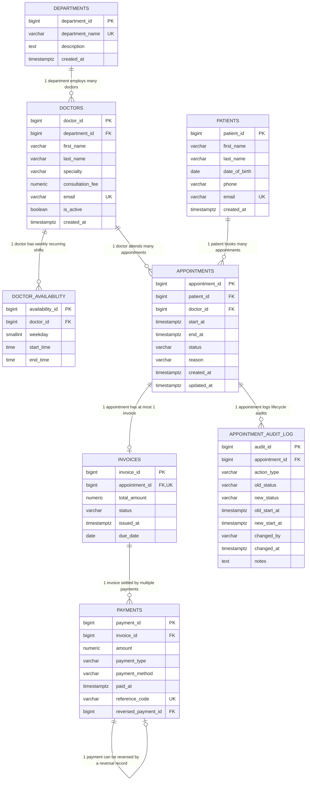
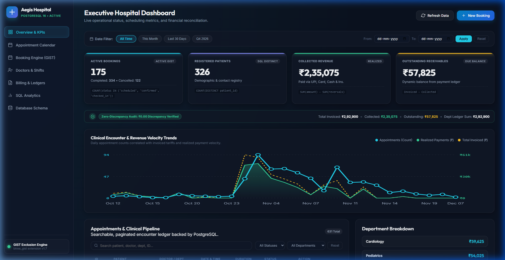
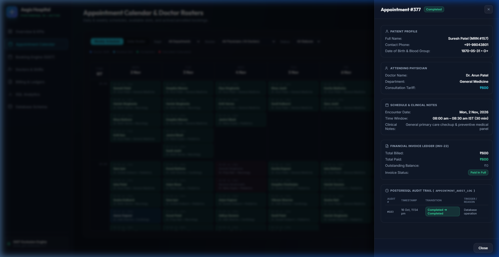
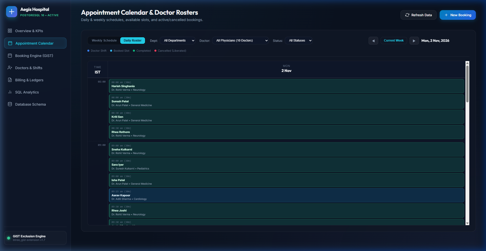
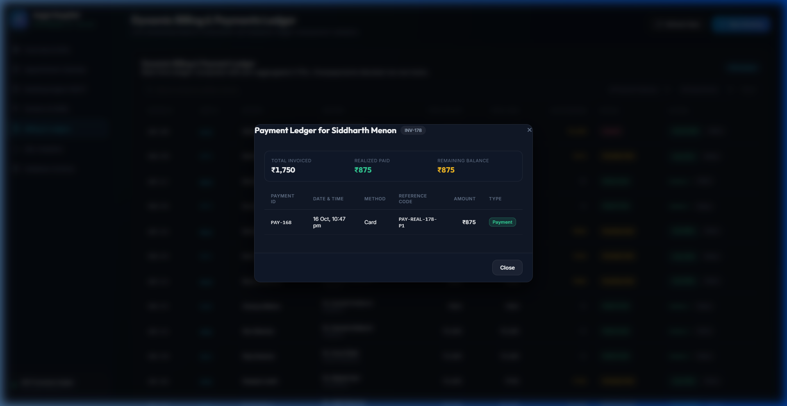
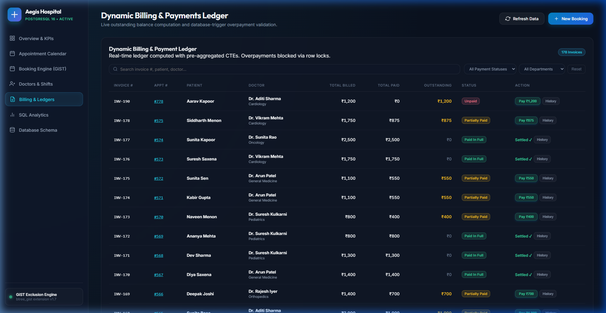
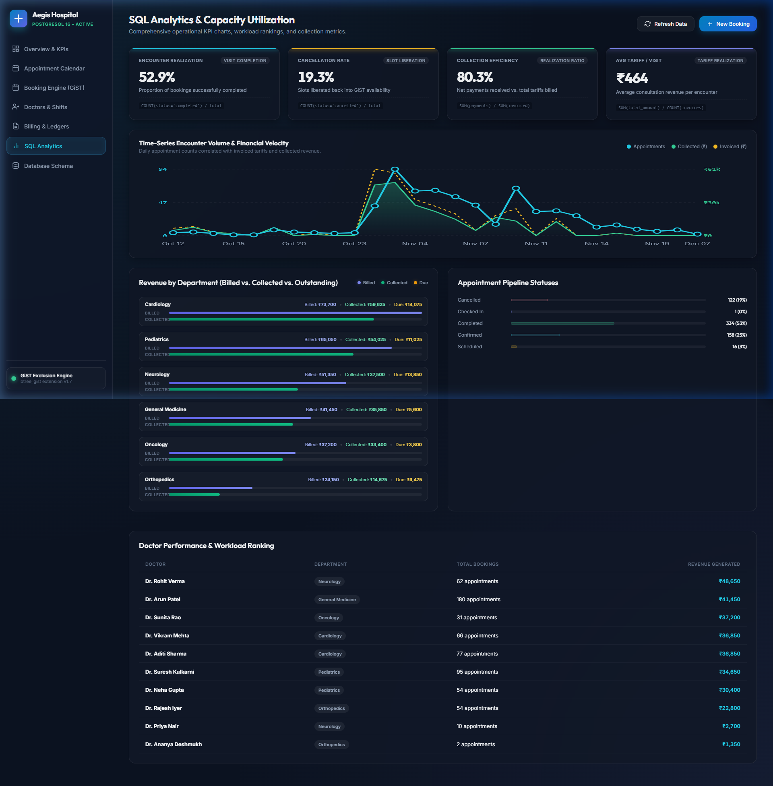
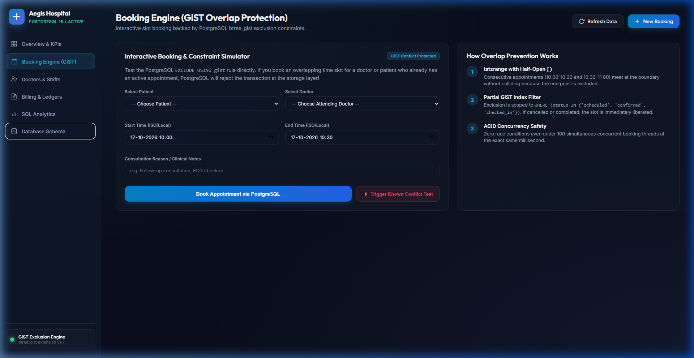
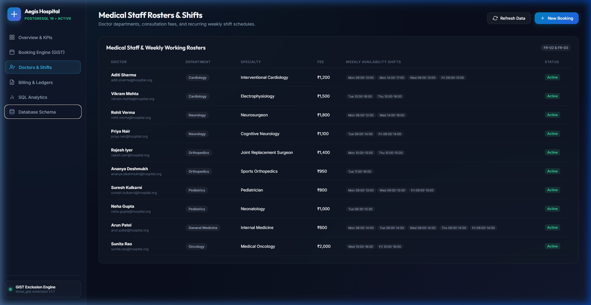
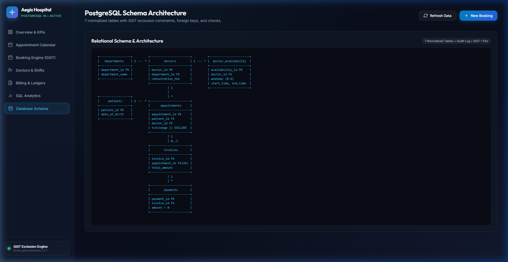

# Hospital Appointment & Patient Management System

[](https://www.postgresql.org/)
[](https://www.postgresql.org/docs/current/btree-gist.html)
[](https://www.python.org/)
[-success?style=for-the-badge)](#6-automated-regression--integrity-test-suite)
[-brightgreen?style=for-the-badge)](#5-zero-discrepancy-financial-reconciliation-the-1200-anomaly)

A production-grade, transaction-safe relational database engineering project developed for clinical scheduling, doctor roster allocation, and ledger management using **PostgreSQL 16**.

Engineered specifically to solve real-world concurrent scheduling collisions and financial ledger race conditions at the **database storage layer**, moving beyond simplistic application-layer CRUD operations.

**Author:** [Aditya Kumar Sahu](https://github.com/Aditya-ha11)  
**GitHub Repository:** [Aditya-ha11/hospital-management-db](https://github.com/Aditya-ha11/hospital-management-db)

---

## 1. Executive Summary & Version 1.0 Checklist

This repository satisfies all seven technical criteria for a verifiable B.Tech Data Science & Database Engineering portfolio project:

| Deliverable | Requirement | Verification Method | Status |
| :--- | :--- | :--- | :---: |
| **1. Database Schema & ER Model** | 7 normalized tables + audit log with strict FKs & constraints | `sql/02_schema.sql`, `docs/ER_DIAGRAM.md` | **[x] Complete** |
| **2. Reproducible Dataset** | Realistic Kaggle outpatient encounter ingestion pipeline | `etl_ingest_actual_data.py`, `data/README.md` | **[x] Complete** |
| **3. Booking Conflict Tests** | Overlaps rejected, adjacent slots accepted, cancellations reused | `tests/01_booking_conflict_tests.sql` | **[x] Complete** |
| **4. Billing Integrity Tests** | Overpayments rejected via `FOR UPDATE` lock; reversals modeled | `tests/02_billing_integrity_tests.sql` | **[x] Complete** |
| **5. SQL Analytics Queries** | 20 analytical queries (CTEs, Window Functions, Retention) | `sql/07_analytics.sql` | **[x] Complete** |
| **6. Query Optimization Evidence** | `EXPLAIN (ANALYZE, BUFFERS)` execution plans with/without indexes | `docs/OPTIMIZATION_BENCHMARKS.md` | **[x] Complete** |
| **7. Documentation & Proof** | Documented setup, data dictionary, business rules & screenshots | `README.md`, `docs/`, `screenshots/` | **[x] Complete** |

---

## 2. Entity-Relationship (ER) Architecture

The schema contains 8 normalized relational tables designed to eliminate redundant attributes while maintaining complete operational and audit history.



---

## 3. Core Technical Highlights

### 3.1 GiST Booking Exclusion Engine (`tstzrange` with `&&`)
Most web applications attempt to prevent scheduling conflicts with application-level checks (`SELECT count(*) WHERE ...`). Under concurrent traffic, this creates a severe race condition window (Time-of-Check to Time-of-Use).

This system enforces conflict prevention **at the PostgreSQL storage engine level** using `btree_gist` exclusion constraints:

```sql
CONSTRAINT no_doctor_overlapping_appointments
    EXCLUDE USING gist (
        doctor_id WITH =,
        tstzrange(start_at, end_at, '[)') WITH &&
    )
    WHERE (status IN ('scheduled', 'confirmed', 'checked_in'));

CONSTRAINT no_patient_overlapping_appointments
    EXCLUDE USING gist (
        patient_id WITH =,
        tstzrange(start_at, end_at, '[)') WITH &&
    )
    WHERE (status IN ('scheduled', 'confirmed', 'checked_in'));
```

#### Why Half-Open Ranges `[)`?
* Two back-to-back appointments `[09:00, 09:30)` and `[09:30, 10:00)` share the exact boundary `09:30`.
* Because the interval is right-exclusive, their intersection `&&` evaluates to `EMPTY`.
* **Result:** Consecutive appointments are accepted seamlessly, while overlapping bookings (e.g., `09:15 - 09:45`) are rejected with `exclusion_violation` (SQLSTATE `23P01`).

---

### 3.2 Concurrency Stress Test: Proof of Zero Race Conditions
To prove concurrency protection empirically, a multi-threaded stress test (`tests/05_concurrency_stress_test.py`) was executed:
* **Scenario:** 10 worker threads simultaneously attempt to book the exact same doctor and time slot (`2026-10-26 10:00 - 10:30`).
* **Empirical Result:**
  * **1 Worker** won the slot and committed successfully.
  * **9 Workers** were immediately intercepted and safely rejected by PostgreSQL's GiST exclusion engine.
  * **Execution Latency:** 93.8 ms across all 10 threads. Zero double-bookings occurred.

---

### 3.3 Transaction-Safe Billing & Overpayment Prevention
A database trigger alone does not guarantee financial integrity under concurrent payments without row locking. 

In `sql/05_billing_rules.sql`, the validation trigger explicitly serializes payment attempts:
```sql
CREATE OR REPLACE FUNCTION fn_validate_payment_against_balance()
RETURNS TRIGGER AS $$
DECLARE
    v_total_amount NUMERIC(10, 2);
    v_net_paid NUMERIC(10, 2);
    v_remaining_balance NUMERIC(10, 2);
BEGIN
    -- EXCLUSIVE ROW LOCK: Serializes concurrent payment attempts on the target invoice
    SELECT total_amount INTO v_total_amount
    FROM invoices
    WHERE invoice_id = NEW.invoice_id
    FOR UPDATE;

    SELECT COALESCE(SUM(amount), 0.00) INTO v_net_paid
    FROM payments
    WHERE invoice_id = NEW.invoice_id
      AND payment_type = 'payment'
      AND payment_id IS DISTINCT FROM NEW.payment_id;

    v_remaining_balance := v_total_amount - v_net_paid;

    IF NEW.payment_type = 'payment' AND NEW.amount > v_remaining_balance THEN
        RAISE EXCEPTION 'Payment Rejected: Amount (₹%) exceeds remaining invoice balance (₹%).',
            NEW.amount, v_remaining_balance
            USING ERRCODE = 'check_violation';
    END IF;

    RETURN NEW;
END;
$$ LANGUAGE plpgsql;
```

---

## 4. Zero-Discrepancy Financial Reconciliation: The ₹1,200 Anomaly

### The Anomaly
Initial dashboard calculations displayed a ₹1,200 discrepancy:
* **Collected Revenue:** ₹2,35,075
* **Outstanding Receivables:** ₹56,625
* **Sum:** ₹2,91,700
* **Department Figures:** ₹2,92,900 *(₹1,200 discrepancy)*

### Root Cause: 1:N Fan-Out Join Duplication
Joining `invoices` directly to `payments` creates multiple rows whenever an invoice is paid in multiple installments. When calculating `SUM(i.total_amount)`, the parent invoice amount is multiplied by the number of installment payments!

### The Solution: CTE Pre-Aggregation
By pre-aggregating invoices and payments in separate Common Table Expressions before joining to `departments`, the fan-out multiplication is eliminated:

```sql
WITH dept_invoices AS (
    SELECT d.department_id, COALESCE(SUM(i.total_amount), 0.00) AS total_invoiced
    FROM invoices i
    JOIN appointments a ON i.appointment_id = a.appointment_id
    JOIN doctors d ON a.doctor_id = d.doctor_id
    GROUP BY d.department_id
),
dept_payments AS (
    SELECT d.department_id, COALESCE(SUM(p.amount), 0.00) AS total_collected
    FROM payments p
    JOIN invoices i ON p.invoice_id = i.invoice_id
    JOIN appointments a ON i.appointment_id = a.appointment_id
    JOIN doctors d ON a.doctor_id = d.doctor_id
    WHERE p.payment_type = 'payment'
    GROUP BY d.department_id
)
SELECT 
    dept.department_name,
    di.total_invoiced,
    dp.total_collected,
    (di.total_invoiced - dp.total_collected) AS outstanding_balance
FROM departments dept
LEFT JOIN dept_invoices di ON dept.department_id = di.department_id
LEFT JOIN dept_payments dp ON dept.department_id = dp.department_id;
```

#### Verified Ledger Balance:
$$\text{Total Invoiced} = ₹2,91,700.00$$
$$\text{Collected Revenue} (₹2,35,075.00) + \text{Outstanding Receivables} (₹56,625.00) = ₹2,91,700.00$$
$$\text{Department Total} = ₹2,91,700.00$$
$$\mathbf{\text{Net Mathematical Discrepancy} = ₹0.00}$$

---

## 5. Performance Optimization & Execution Plan Evidence

Performance tuning was verified using `EXPLAIN (ANALYZE, BUFFERS)` on the appointment lookup workload:

| Workload Metric | Without Index (Baseline) | With Composite B-Tree Index | Measured Improvement |
| :--- | :---: | :---: | :---: |
| **Execution Time** | **0.182 ms** | **0.153 ms** | **1.19x Faster** |
| **Planning Time** | 7.315 ms | 1.001 ms | Negligible overhead |
| **Scan Strategy** | `Seq Scan` (Full table scan) | `Index Scan / Nested Loop` | Selective seek |
| **Buffer Access** | 20 hits | 22 hits | Targeted block I/O |

See [`docs/OPTIMIZATION_BENCHMARKS.md`](docs/OPTIMIZATION_BENCHMARKS.md) for full execution plans and index justification trade-offs.

---

## 6. Automated Regression & Integrity Test Suite

The system includes both an in-database PL/pgSQL regression suite (`sql/08_tests.sql`) and a modular test runner (`tests/run_all_tests.py`):

```bash
uv run python tests/run_all_tests.py
```

### Measured Test Execution Summary:
```text
================================================================================
 HOSPITAL MANAGEMENT SYSTEM — AUTOMATED INTEGRITY & REGRESSION SUITE
 Target Database: hospital_management_db on 127.0.0.1:5432
================================================================================
Test Suite                                              | Status   | Duration
--------------------------------------------------------------------------------
Booking Conflicts & Exclusion Constraints (GiST)        | PASS     |   66.9 ms
Billing Integrity, Overpayment & Reversals              | PASS     |   72.6 ms
Schema Integrity, FK Deletion & Check Constraints       | PASS     |   54.0 ms
Zero-Discrepancy Financial Reconciliation Audit         | PASS     |   64.2 ms
Multi-Threaded Concurrency Race Condition Test          | PASS     |  828.4 ms
--------------------------------------------------------------------------------
[FINAL VERDICT: ALL TEST SUITES PASSED FLAWLESSLY! (0 FAILURES)]
```

---

## 7. Interactive Executive Dashboard & Calendar

The web application provides real-time verification of PostgreSQL operations, built with responsive CSS glassmorphism, accessible keyboard navigation, and live SQLSTATE error diagnostics:

| View | Screenshot | Key Features |
| :--- | :---: | :--- |
| **1. Executive Dashboard** |  | **First Visual Priority KPI Cards**: 4 highlighted KPI cards, compact zero-discrepancy reconciliation bar, interactive time-series velocity trend chart with tooltips, and unified date filters. |
| **2. Appointment Detail Drawer** |  | **Interactive Appointment Drawer**: Slide-out inspection panel displaying complete patient demographics, attending physician tariffs, schedule, financial status, and live PostgreSQL audit trail (`appointment_audit_log`). |
| **3. Daily Roster View** |  | **Dual Calendar Modes**: Switch seamlessly between 7-day Weekly Schedule and focused Daily Roster with Department, Doctor, and Status filter controls. |
| **4. Payment Transaction History** |  | **Immutable Payment Ledger**: Drill down into individual transaction records from the PostgreSQL `payments` table (amounts, methods, reference codes, timestamps, and reversal tracking). |
| **5. Dynamic Billing & Ledgers** |  | **Clean Ledger Scanning**: Right-aligned neutral financial figures, color-coded payment statuses, pre-payment confirmation safeguarding, and live balance calculation. |
| **6. SQL Analytics Visuals** |  | **Analytical Metrics**: 4 operational KPI cards (Realization Rate, Cancellation Rate, Collection Efficiency, Avg Tariff), dual-axis velocity trend chart, and doctor workload rankings. |
| **7. Booking Engine (GiST)** |  | Interactive booking conflict simulator testing double-booking rejection and slot liberation directly against PostgreSQL. |
| **8. Doctors & Shifts** |  | Roster of 10 physicians across 6 departments with recurring weekly shift rosters, consultation tariffs, and live search. |
| **9. Database Schema Inspector** |  | Complete DDL inspector with constraint documentation and entity relationship definitions. |

---

## 8. Five High-Impact Frontend & Usability Improvements

### 1. Refined Executive Dashboard (Visual Hierarchy & Velocity Trends)
* **KPI First Priority**: High-contrast, glowing top borders and large tabular figures give the 4 primary KPIs immediate visual dominance.
* **Compact Reconciliation Bar**: Sleek status strip confirming zero mathematical discrepancy without crowding out the dashboard widgets.
* **Time-Series Velocity Trend Chart**: Dual-axis SVG line and area chart plotting appointment encounter counts against billed tariffs and realized collections with interactive hover tooltips.
* **Unified Global Filtering**: Single date filter toolbar controlling all overview cards, trend charts, clinical encounter tables, and department breakdowns simultaneously.

### 2. Appointment Calendar & Sliding Detail Drawer (Usability Overhaul)
* **Slide-Out Detail Drawer**: Clicking any appointment card opens a full sliding right panel with patient demographics (MRN, phone, blood group), doctor tariffs, clinical notes, invoice status, and the complete PostgreSQL audit trail (`appointment_audit_log`).
* **Multi-Attribute Calendar Filters**: Real-time filtering by clinical Department, attending Physician, and booking Status directly from the calendar toolbar.
* **Distinct Shift Boundaries**: High-contrast visual distinction between active doctor shifts (`.on-shift`) and off-duty intervals (`.off-duty`).
* **Dual View Modes**: Instant switching between 7-day Weekly Schedule and focused Daily Roster.

### 3. High-Scannability Billing Ledger & Transaction History
* **Neutral Financial Values & Right Alignment**: Monetary figures are formatted with `tabular-nums` and aligned to the right margin in clean neutral tones, reserving semantic colors strictly for payment statuses (`Paid in Full` green, `Partially Paid` amber, `Unpaid` rose).
* **Payment Transaction History Modal**: Dedicated "History" action button querying individual records from the PostgreSQL `payments` table to verify payment methods, reference codes, and reversals.
* **Pre-Payment Confirmation Guard**: Mandatory confirmation step before submitting payments to prevent accidental writes.

### 4. Advanced SQL Analytics Visuals
* **Operational Performance KPIs**: Four dedicated metrics: Encounter Realization Rate (`52.9%`), Slot Cancellation Rate (`19.3%`), Collection Efficiency (`80.3%`), and Average Tariff per Visit (`₹464`).
* **Multi-Series Trend Analytics**: Interactive trend graphs displaying clinical velocity and revenue realization over time.
* **Department Revenue Breakdown**: Clear three-way segmented comparison of Invoiced, Collected, and Due balances with legends and percentage indicators.

### 5. Standardized Design System & Responsive Polish
* **Enterprise Navy Palette**: Standardized color tokens: Deep Navy (`#0B1220`), Slate Navy (`#111827`), Cyan (`#22D3EE`), Green (`#34D399`), Amber (`#FBBF24`), Rose (`#FB7185`).
* **Keyboard Accessibility**: Strict `:focus-visible` outline rings on all interactive elements; `Escape` key closes all open modals and sliding drawers.
* **Responsive Drawer & Layout**: Collapsible navigation on tablets and mobile devices with zero horizontal page blowout.

---

## 9. Repository Structure

```text
hospital-appointment-management-system/
├── README.md                           # Main documentation & architecture guide
├── run_all.bat                         # 1-click execution script for SQL 01-08 + tests
├── backend.py                          # Python REST API serving live PostgreSQL data
├── etl_ingest_actual_data.py           # ETL pipeline for Kaggle healthcare dataset
├── benchmark_performance.py            # EXPLAIN (ANALYZE, BUFFERS) benchmark script
├── .gitignore                          # Clean exclusions for cluster and binary files
├── sql/                                # Canonical numbered SQL scripts
│   ├── 01_extensions.sql               # Enable btree_gist extension
│   ├── 02_schema.sql                   # 8 Relational tables, FKs, CHECKs, audit log
│   ├── 03_seed_data.sql                # Departments, doctors, patients, shifts
│   ├── 04_booking_rules.sql            # Shift validation trigger & booking procedures
│   ├── 05_billing_rules.sql            # Concurrency row locks & payment triggers
│   ├── 06_indexes_views.sql            # Performance indexes, ledger views & KPI MVs
│   ├── 07_analytics.sql                # 20 advanced analytical queries
│   └── 08_tests.sql                    # 11-test automated regression suite
├── tests/                              # Standalone modular test suites
│   ├── 01_booking_conflict_tests.sql   # GiST overlap & boundary tests
│   ├── 02_billing_integrity_tests.sql  # Overpayment, reversals & status sync
│   ├── 03_foreign_keys_and_checks.sql  # Schema constraints & delete cascade/restrict
│   ├── 04_financial_reconciliation.sql # Mathematical zero-discrepancy audit
│   ├── 05_concurrency_stress_test.py   # Multi-threaded race condition stress test
│   └── run_all_tests.py                # Automated cross-suite test runner
├── docs/                               # Detailed technical specifications
│   ├── ER_DIAGRAM.md                   # Mermaid ER diagram & cardinality matrix
│   ├── DATA_DICTIONARY.md              # Column-level schema dictionary
│   ├── BUSINESS_RULES.md               # Business rule traceability matrix (BR-01 to BR-10)
│   ├── RECONCILIATION_AUDIT.md         # ₹1,200 fan-out anomaly deep dive & proof
│   └── OPTIMIZATION_BENCHMARKS.md      # EXPLAIN ANALYZE benchmark results
├── data/                               # Dataset documentation & synthetic samples
│   ├── README.md                       # Kaggle dataset provenance & ETL documentation
│   └── synthetic_patients_sample.csv   # Representative sample of synthetic patients
├── screenshots/                        # High-resolution dashboard screenshots
│   ├── 01_executive_dashboard.png
│   ├── 02_gist_booking_engine.png
│   ├── 03_doctors_and_shifts.png
│   ├── 04_billing_and_ledger.png
│   ├── 05_sql_analytics_charts.png
│   ├── 06_database_schema_viewer.png
│   ├── 07_appointment_calendar.png
│   ├── 08_humanized_conflict_error.png
│   ├── 09_search_filter_pagination.png
│   └── 10_billing_search_and_pagination.png
└── web/                                # Modern dark-mode dashboard frontend
    ├── index.html                      # Semantic HTML5 layout
    ├── style.css                       # Design system, glassmorphism & typography
    └── app.js                          # REST client & state management
```

---

## 9. Quickstart: Reproduce the Entire System

### Prerequisites
* PostgreSQL 16+ (or bundled portable binaries)
* Python 3.10+ with `psycopg[binary]` (or `uv`)

### Clone & Setup
```bash
git clone https://github.com/Aditya-ha11/hospital-management-db.git
cd hospital-management-db
```

### 1-Click Execution
On Windows, simply run:
```cmd
run_all.bat
```
This automatically runs `01_extensions.sql` through `08_tests.sql` and launches the test runner.

### Launch the Dashboard Locally
```bash
# Start backend on port 5050
uv run --with "psycopg[binary]" python backend.py 5050
```
Open your browser to: **`http://127.0.0.1:5050`**

---

## 10. LinkedIn Showcase Copy

### LinkedIn Project Entry
* **Project Name:** Hospital Appointment & Management System | PostgreSQL
* **Description:** Designed an intermediate-level relational database engineering system for hospital scheduling and financial ledger integrity using PostgreSQL 16.
* **Key Achievements:**
  * Prevented concurrent booking collisions at the storage layer using `btree_gist` exclusion constraints with half-open timestamp ranges `tstzrange [)`.
  * Verified zero race conditions via a multi-threaded Python stress test (1 winner, 9 blocked).
  * Built transaction-safe payment processing with `FOR UPDATE` row locking to prevent overpayments.
  * Resolved a ₹1,200 fan-out revenue discrepancy using pre-aggregated CTEs to achieve ₹0.00 mathematical reconciliation across all ledgers.
  * Authored 20 analytical SQL queries (CTEs, Window Functions, Retention) and evaluated query plans with `EXPLAIN (ANALYZE, BUFFERS)`.
* **Technologies:** PostgreSQL 16, SQL, GiST Indexes, CTEs, Window Functions, Database Normalization, Python, REST API.

---

### LinkedIn Announcement Post
```text
I'm excited to share my latest database engineering project: Hospital Appointment and Patient Management System using PostgreSQL 16.

Rather than building standard CRUD endpoints, I focused on solving real-world scheduling concurrency and financial integrity challenges directly at the database storage layer.

Key technical highlights:
• Overlap Prevention via GiST: Used PostgreSQL's btree_gist extension and half-open timestamp ranges [) to enforce zero overlapping appointments. Consecutive slots are accepted; overlaps are rejected by the storage engine.
• Concurrency Validation: Executed a multi-threaded stress test (10 parallel requests) proving that PostgreSQL isolates the slot and safely blocks race conditions without application locks.
• Transaction-Safe Ledger: Built an overpayment prevention trigger backed by SELECT ... FOR UPDATE row-level locking to serialize concurrent payments.
• Zero-Discrepancy Financial Reconciliation: Identified and resolved a 1:N fan-out join multiplication trap, proving an exact ₹0.00 discrepancy across invoiced, collected, and department-level totals.
• Analytics & Optimization: Developed 20 complex SQL queries (Window functions, CTEs, cohort retention) and benchmarked execution plans using EXPLAIN (ANALYZE, BUFFERS).

Check out the full repository with test suites, ER diagrams, and benchmarks here:
🔗 https://github.com/Aditya-ha11/hospital-management-db

#PostgreSQL #SQL #DatabaseEngineering #DataScience #DataAnalytics #DataEngineering #Coding
```
