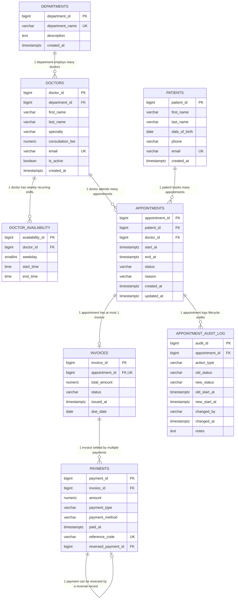

# Entity-Relationship (ER) Model & Architecture

This document specifies the relational data model for the Hospital Appointment and Patient Management System, including entity definitions, relationship cardinalities, foreign key actions, and PostgreSQL-specific GiST exclusion constraints.

---

## 1. Mermaid Visual ER Diagram



---

## 2. Cardinality & Relationship Matrix

| Entity A | Entity B | Cardinality | Enforcing Constraint | Deletion Rule | Design Rationale |
| :--- | :--- | :---: | :--- | :--- | :--- |
| **Department** | **Doctor** | `1:N` | `fk_doctor_department` | `ON DELETE RESTRICT` | Prevents deleting a clinical department that has active staff. |
| **Doctor** | **Availability** | `1:N` | `fk_availability_doctor` | `ON DELETE RESTRICT` | A doctor can have multiple distinct morning/afternoon weekly shifts. |
| **Doctor** | **Appointment** | `1:N` | `fk_appointment_doctor` | `ON DELETE RESTRICT` | Doctors attend numerous patient appointments over time. |
| **Patient** | **Appointment** | `1:N` | `fk_appointment_patient` | `ON DELETE RESTRICT` | Clinical history cannot be deleted while referenced by bookings. |
| **Appointment** | **Invoice** | `1:0..1` | `fk_invoice_appointment` + `UNIQUE(appointment_id)` | `ON DELETE RESTRICT` | Strict 1:0..1 coupling; an appointment can have at most one invoice. |
| **Invoice** | **Payment** | `1:N` | `fk_payment_invoice` | `ON DELETE RESTRICT` | Invoices can be paid in full, through partial installments, or co-pay. |
| **Appointment** | **Audit Log** | `1:N` | `fk_audit_appointment` | `ON DELETE CASCADE` | Complete timeline of reschedules, status transitions, and cancellations. |
| **Payment** | **Payment (Reversal)** | `1:0..1` | `fk_payment_reversal` | `ON DELETE RESTRICT` | Self-referencing FK models refund/reversal records without deleting history. |

---

## 3. Database-Level Overlap Isolation Engine

```sql
CONSTRAINT no_doctor_overlapping_appointments
    EXCLUDE USING gist (
        doctor_id WITH =,
        tstzrange(start_at, end_at, '[)') WITH &&
    )
    WHERE (status != 'cancelled');

CONSTRAINT no_patient_overlapping_appointments
    EXCLUDE USING gist (
        patient_id WITH =,
        tstzrange(start_at, end_at, '[)') WITH &&
    )
    WHERE (status != 'cancelled');
```

### Why Half-Open Ranges `[)`?
* `[10:00, 10:30)` and `[10:30, 11:00)` share the exact instant `10:30`.
* Because the interval is right-exclusive, their intersection `&&` evaluates to `EMPTY`.
* Result: Consecutive back-to-back appointments are accepted, but any real overlapping collision (e.g. `10:15 - 10:45`) is blocked.
